# ComputerForce

## Project Overview

ComputerForce is a responsive e-commerce website developed as part of my Information Technology studies at the Australian College of Business Intelligence (ACBI).

The project simulates an online electronics store, focusing on front-end development, product organisation, interactive functionality and user experience.

## Technologies Used

- HTML5
- CSS3
- JavaScript
- Git & GitHub

## Key Features

- Responsive multi-page website
- Product catalogue with 12 categories
- Interactive product search
- Product search results with visual highlighting
- Shopping cart with LocalStorage persistence
- Add and remove product functionality
- Automatic quantity and subtotal calculation
- Interactive checkout modal
- Order summary and confirmation
- Automatic cart clearance after order confirmation
- User registration form
- Mobile-friendly hamburger navigation
- Web accessibility features

## Checkout Demonstration

The checkout functionality simulates an online
purchase process, including cart validation,
order summary and order confirmation.

This project is for demonstration purposes only.
No real payments are processed.

## Screenshots

### Homepage
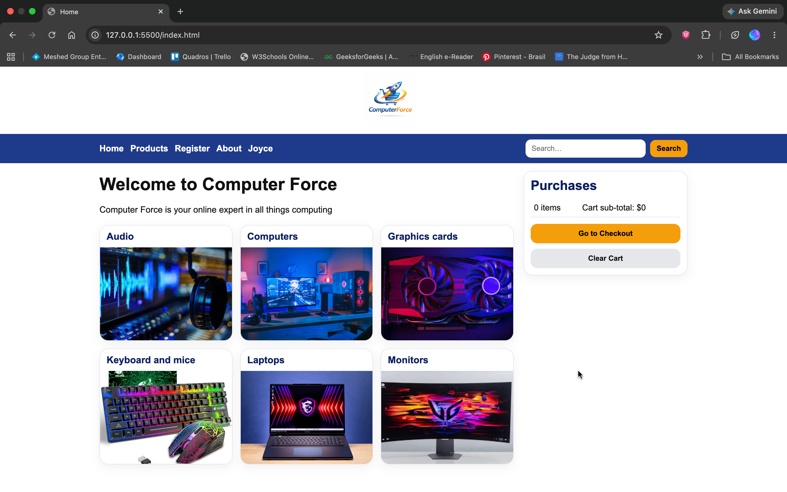

### Product Catalogue
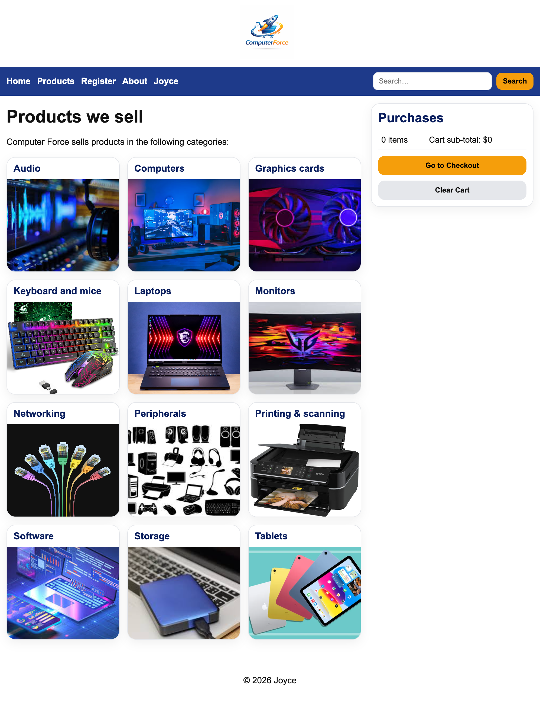

### Product Category
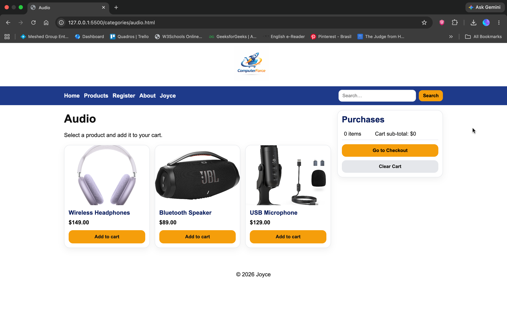

### Product Search
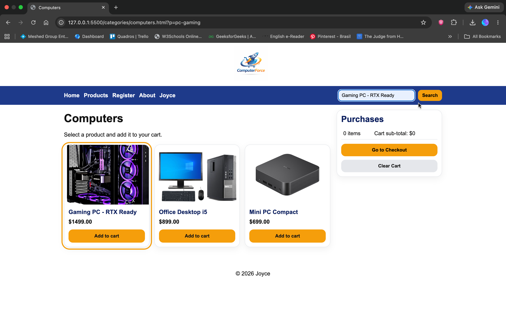

### Shopping Cart
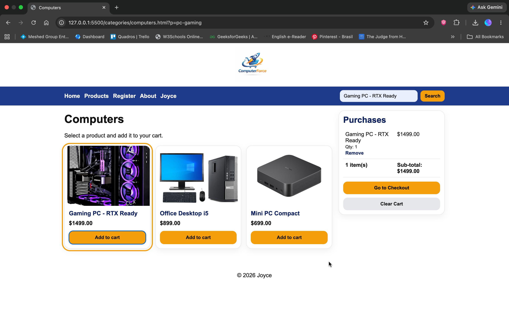

### Checkout
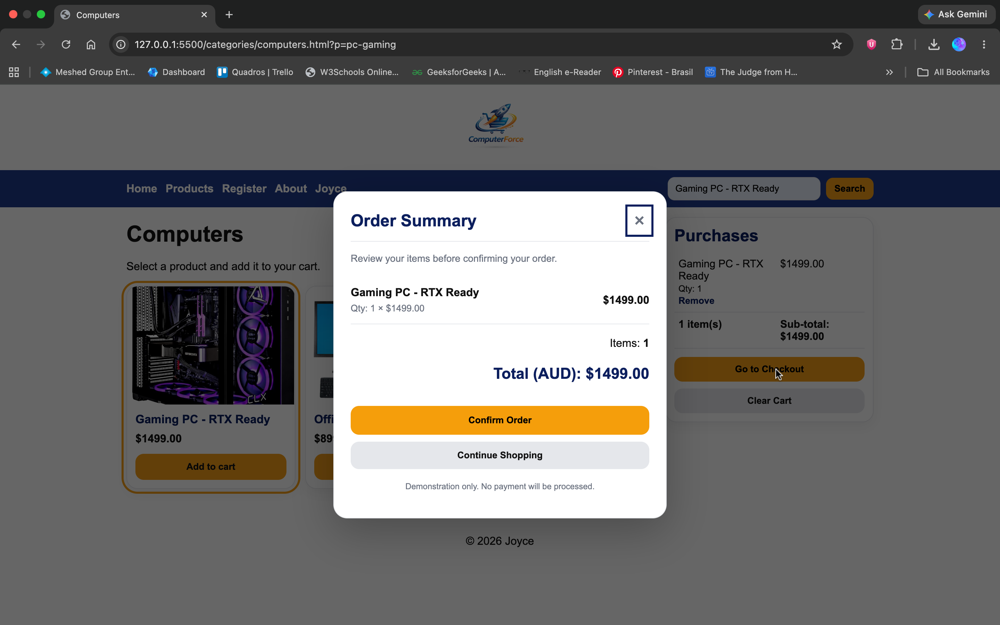

### Order Confirmation
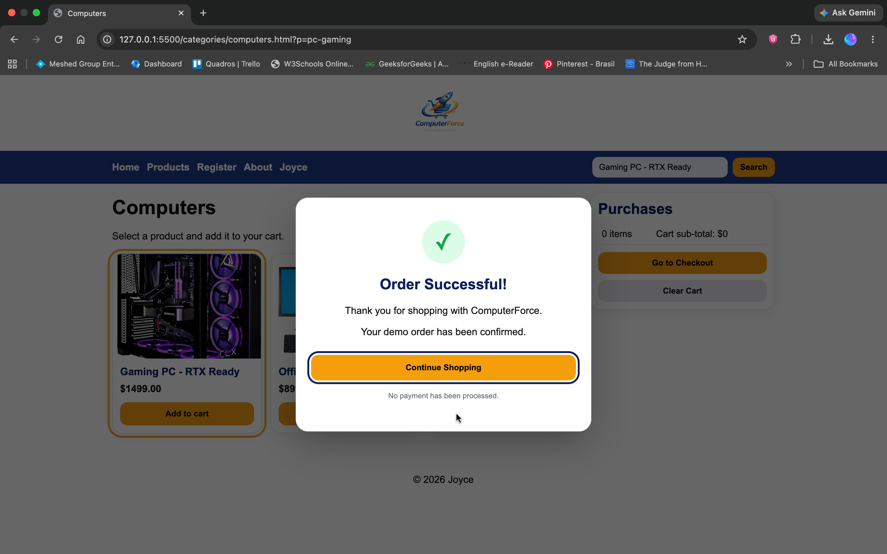

### Registration Form
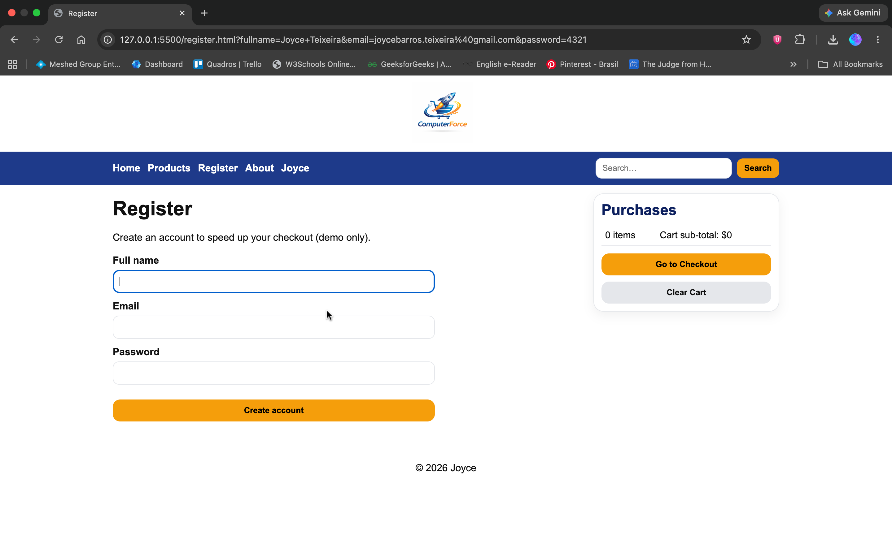

### Developer Profile
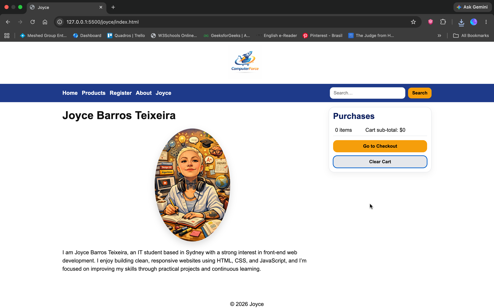

### Mobile Responsive Design
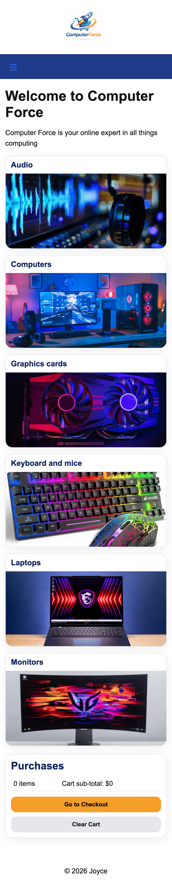

### Mobile Checkout
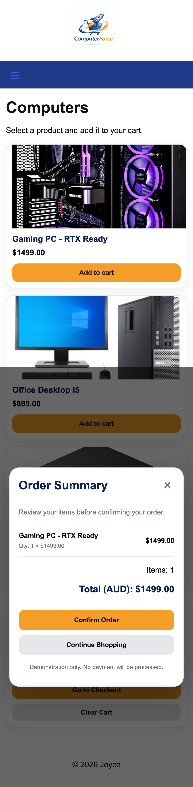

## How to Run the Project

1. Clone or download this repository.
2. Open the project folder in Visual Studio Code.
3. Run index.html using the Live Server extension.

## Project Purpose

This academic project demonstrates my practical skills in front-end development, interactive web interfaces, website organisation and e-commerce design.

## Author

Joyce Barros Teixeira
Information Technology Student | Front-End Web Developer
Sydney, Australia
